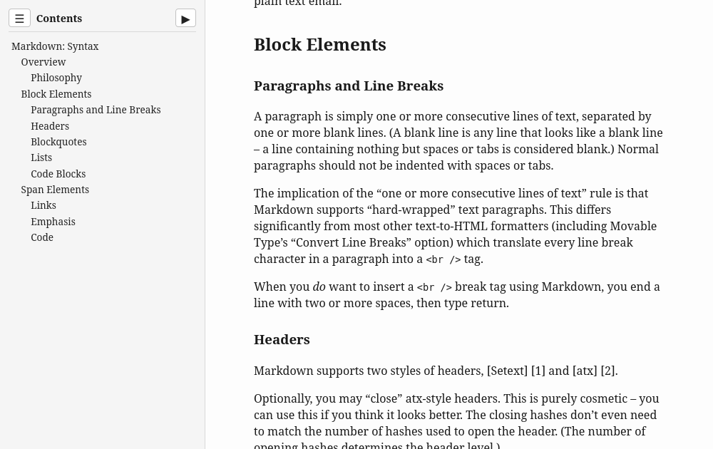

# Pandoc Floating Sidebar TOC

Pandoc Lua filter that transforms the Pandoc's generated table of contents
into a collapsible left floating sidebar in standalone HTML output.

## Usage

Everything is contained in the `floating-sidebar-toc.lua` file.
Call Pandoc with:

```
pandoc -s --toc --lua-filter floating-sidebar-toc.lua -o output.html input.md
```

(Works also with YAML metadata that specifies custom "maxwidth".)

As a side note, if you have Mermaid diagrams or similar embedded in your
markdown files, you can also have them rendered in a self-contained way to your
HTML output. First, make sure you have `mermaid-cli` installed (from NPM or
similar), and `pandoc-filter-diagram` package installed (from apt or similar
distro package manager). Then call Pandoc with:

```
pandoc -s --embed-resources --toc --lua-filter /usr/share/pandoc/filter/diagram/diagram.lua --lua-filter floating-sidebar-toc.lua -o output.html input.md
```

## Screenshot



## Licensing

SPDX-License-Identifier: 0BSD

Copyright (C) 2026 by oko256
(https://github.com/oko256/pandoc-floating-sidebar-toc)

Permission to use, copy, modify, and/or distribute this software for any
purpose with or without fee is hereby granted.

THE SOFTWARE IS PROVIDED "AS IS" AND THE AUTHOR DISCLAIMS ALL WARRANTIES WITH
REGARD TO THIS SOFTWARE INCLUDING ALL IMPLIED WARRANTIES OF MERCHANTABILITY AND
FITNESS. IN NO EVENT SHALL THE AUTHOR BE LIABLE FOR ANY SPECIAL, DIRECT,
INDIRECT, OR CONSEQUENTIAL DAMAGES OR ANY DAMAGES WHATSOEVER RESULTING FROM
LOSS OF USE, DATA OR PROFITS, WHETHER IN AN ACTION OF CONTRACT, NEGLIGENCE OR
OTHER TORTIOUS ACTION, ARISING OUT OF OR IN CONNECTION WITH THE USE OR
PERFORMANCE OF THIS SOFTWARE.
